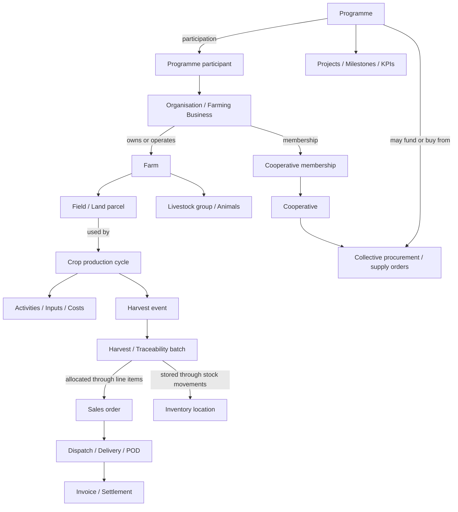

# Farmer Plus — Domain & Workflow Blueprint (Phase 1)

Date: 2026-10-28
Repository: SmartifyConsulting/norias-farm-hub, branch main
Status: architecture proposal grounded in inspected source; no production data migration or UI change.
Purpose: replace a flat catalogue of functions with contextual, linked journeys. This document supersedes no existing implementation.

## Evidence and important distinctions

- `src/lib/farm.ts`: `MINI_APPS` includes farm/assets, animals, fields, crops, tasks, treatments, harvest, stock, maintenance, finance, compliance and more. Generic `FarmRecord` already supports `farmId`, `fieldId`, `cropId`, `animalId`; not all workflows require or populate these IDs.
- `src/components/Dock.tsx`: top-level navigation is Home / My Apps / Trades / Tasks / Wallet, i.e. feature destinations rather than an operating lifecycle.
- `src/lib/network.ts`: opportunity pipeline stages Opportunity → Assessment → Decision → Commitment → Action → Outcome. Traceability stores a separate `Batch` and editable step values; its type does not link to a production record or a sales order.
- `src/lib/valuechain.ts`, `src/routes/logistics.tsx`: vehicles, facilities and transport/storage bookings, including capacity and booking status. Booking does not have a typed sales-order or harvest-batch foreign key.
- `src/lib/coop-trade.ts`, `src/routes/coop.$coopId.purchasing.tsx`: cooperative purchasing has requests, orders and allocations, with Supabase persistence. These are not equivalent to institutional food procurement.
- `src/lib/govprogrammes.ts`, `src/routes/gov-programmes.tsx`: curated programme *directory*, not an operational programme entity.
- `drizzle/migrations/0000_value_chain_records.sql`: generic value-chain records include `farm_id` and row-level security.
- `docs/PLATFORM_AUDIT.md` is dated 2026-10-12 and describes some features as missing that are now present (for example cooperative purchasing and additional mini-apps). Treat it as a historical snapshot, not current truth.
- No database deployment or live-data validation was performed. A route or type proves code exists, not that an end-to-end transaction works.

## Proposed domain model (not all entities exist today)

Cardinality rules:
1. Organisation ↔ farm: model ownership/operation explicitly; farm ↔ people through membership and role records.
2. Farm → fields; field ↔ crop cycles (one field can have successive cycles; one cycle may cover multiple fields, requiring a join table if supported).
3. Crop cycle → harvest events → batches. One batch can be split across several order lines; an order can contain multiple batches. Use allocation records; do not force a single parent.
4. Batch ↔ storage location via stock movements; stock must never be inferred from free-text labels.
5. Cooperative ↔ organisations/farmers via memberships. A farmer can belong to multiple cooperatives.
6. Programme ↔ farms, organisations and cooperatives via participation records; a participant can join multiple programmes. Programme is not the parent/owner of a farm.
7. Sales order → fulfilment → POD → invoice/payment; separate actual and expected quantities and statuses.

## Primary farmer journey

1. **Set up** business, farm, fields, livestock and people. Output: active farm context.
2. **Plan production** by crop cycle or livestock production activity. Output: planned dates, area, yield and costs.
3. **Operate** tasks, inputs, treatments, inspections, maintenance and expense records linked to the active cycle.
4. **Harvest / produce** actual yield and create traceable batches; validate unit, quantity and source.
5. **Allocate stock** to own storage, cooperative supply, or a buyer order; track available vs reserved vs dispatched quantities.
6. **Fulfil** confirm order, reserve stock, book transport, dispatch, record delivery and exception.
7. **Settle** invoice/receipt/payment and reconcile expected vs actual amount.
8. **Review** yield, costs, margin, outstanding actions and programme outcomes.

Alternative journeys:
- **Cooperative**: invite/approve members → aggregate demand or supply → create order → allocate by member → fulfil → reconcile.
- **Buyer**: publish requirement → source/approve suppliers → place order → receive → reconcile.
- **Programme manager**: establish programme → enrol participants → assign support/projects → monitor milestones/outputs → verify evidence → report.
- **Livestock farmer**: livestock registration → husbandry/health → production or sale → fulfilment; do not force a crop/harvest workflow.

## Navigation proposal

Top-level:
- **My Business**: farms, team, fields, livestock, assets, compliance.
- **Production**: plans/cycles, tasks, inputs, harvest, stock.
- **Trade & Delivery**: opportunities, collective supply, purchasing, sales, logistics, payments.
- **Networks & Programmes**: cooperatives, programme directory, programme participation/administration, shared capacity, funding.
- **Performance**: costs and sales, profitability, traceability, outcomes, risks and reports.

Provide a persistent **Working in: [farm/cooperative/programme]** context selector. Every detail page needs breadcrumbs, a parent summary, linked records, current status, a next recommended action and a history. Avoid treating a user-selected persona as an access-control role.

## Programme terminology

**Programme directory** (existing): public information about grants and support opportunities; Track this feeds the opportunity pipeline.

**Operational programme** (proposed): managed initiative with sponsor, administrator, objective, timeframe, geography, funding, projects, participants, eligibility, milestones, KPIs, activities and evidence. A programme can coordinate farmers/cooperatives without owning their farms. DBE ECD nutrition would be one specialised programme with recipient centres, menus, warehousing, packing, delivery and audit workflows; those specialised entities should not be imposed on ordinary farmers.

## Gap matrix

| Area | Source evidence | Gap / proposed action |
|---|---|---|
| Farm activities | Generic FarmRecord links to farm/field/crop | Enforce contextual creation, show linked record timeline; verify referential integrity |
| Crop → harvest | Crop and harvest mini-apps | Verify typed harvest-to-cycle relationship; add if missing |
| Harvest → traceability | Separate `Batch` type with free-text steps | Add typed batch origin and stock movements; retain old records |
| Stock → sale | Stock mini-app and separate cooperative sales | Introduce allocations between batch, order line and inventory |
| Sale → delivery | Sales/order models and independent logistics bookings | Add explicit order fulfilment, dispatch, POD and exception records |
| Delivery → settlement | Cooperative paid/delivered flags and wallet/finance tools | Reconcile invoices, receipts and payment records by transaction |
| Farm ↔ cooperative | Memberships and cooperative trade modules | Surface membership context and cross-links from farm and orders |
| Programme | Government directory only in inspected routes | Separate programme entity, enrolment and reporting |
| Navigation | Flat dock and mini-app directory | Introduce contextual IA; preserve legacy deep links |
| Identity/permissions | Farm and cooperative role concepts | Audit RLS before unifying organisational contexts |
| DBE nutrition | No verified ECD/menus/packing/POD workflow | Optional institutional programme extension after core lifecycle |

## Safe implementation sequence

**Gate 0 — Verify**: inspect current Supabase schema, migrations, RLS and runtime behavior; identify live data and confirm backup/rollback. Never expose secrets. Check the tracked `.env` file for secrets locally in a secure workflow and rotate if necessary.

**Gate 1 — Navigation only**: implement a unified route registry and five lifecycle groups, plus breadcrumb and working-context display. Preserve existing URLs, routes and records. Validate desktop/mobile navigation and authentication.

**Gate 2 — Relationships**: add additive typed linking entities/migrations only after schema audit. Backfill safely with unresolved/legacy status; never silently fabricate associations.

**Gate 3 — Guided workflows**: implement one complete crop-to-cash journey using existing components. Test farm → cycle → harvest → batch → sale → dispatch → payment with both success and exception cases.

**Gate 4 — Other actors**: cooperative, buyer and programme-manager journeys, with role-based access and isolation tests.

**Gate 5 — Institutional extension**: DBE-specific demand, nutrition, warehouses, packing, deliveries and reporting; keep configurable and optional.

## Acceptance criteria

- A new user can identify where to start and what to do next without opening a mini-app catalogue.
- Every transaction detail has an identifiable parent/context, related records, stage and history.
- All relevant entities support one-to-many and many-to-many relationships without duplicate profiles.
- User can follow one sale from production source to payment, with quantities reconciled.
- A farm can participate in several programmes/cooperatives without ownership confusion.
- Existing records, deep links, offline behavior and access permissions remain functional.
- No live schema changes or destructive data migration without verified backups, RLS checks and test evidence.

## Explicit non-goals for this phase

No application code edits, DB migration, production deployment, UI redesign, or claim that the DBE institutional workflows already exist.
